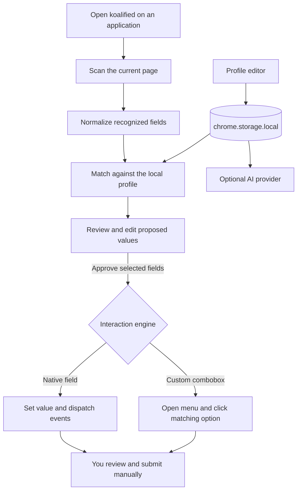

<p align="center">
  
</p>

<h1 align="center">koalified</h1>

<p align="center"><em>a little help with applications.</em></p>

<p align="center">
  A local-first Chrome extension that helps fill repetitive job-application fields—without taking control away from you.
</p>

## What it does

koalified keeps your reusable application details in your local Chrome profile, recognizes matching fields on an application page, and lets you review every proposed value before filling.

The current version includes:

- An in-popup profile editor for contact details, location, links, and education, with advanced experience, résumé, and AI settings available from the gear menu.
- Structured phone input with selectable country calling codes while retaining a combined number for application forms.
- Country selection plus province/state suggestions for Canada and the United States.
- Generic field recognition using labels, accessibility attributes, names, IDs, and placeholders.
- A review panel where values can be edited, included, or excluded before filling.
- Native text, select, date, and month input handling with framework-compatible events.
- Accessible custom-combobox interaction that opens the menu and clicks a matching option.
- Configurable degree fallbacks, such as `Computer Engineering` → `Engineering`.
- Optional Gemini or Groq/OpenAI-compatible AI configuration for future short-answer drafts.
- An explicit `Alt+A` shortcut for user-triggered one-click filling.

Dedicated Greenhouse, Lever, Ashby, SmartRecruiters, and Workday adapters will build on the same matching and interaction engine.

## How it works



## Privacy and control

koalified is designed for a private, trusted browser profile:

- Profile data and API configuration stay in `chrome.storage.local`.
- Nothing is filled without an explicit user action.
- The review-first workflow shows proposed values before changing the page.
- Unknown fields are left blank instead of guessed.
- Passwords, verification codes, CAPTCHAs, uploads, and submission controls are ignored.
- koalified never clicks **Next**, **Apply**, **Create account**, or **Submit**.
- AI requests occur only when explicitly requested and use the provider you configure.

Chrome clears local extension data when an extension is removed. Keep your original résumé and profile information elsewhere. API keys are stored as plain extension data, not in an operating-system keychain.

## Install locally

No Chrome Web Store account or fee is needed.

1. Clone or download this repository.
2. Open `chrome://extensions` in Chrome.
3. Enable **Developer mode**.
4. Click **Load unpacked** and select this repository directory.
5. Pin koalified and use **My profile** inside the popup to add your core information.
6. Use the gear menu for experience, résumé, and optional AI settings.
7. Open a job application and choose **Review this page**.

After pulling or editing code, reload the extension from `chrome://extensions` and refresh the application page.

## Development

The extension currently has no runtime dependencies or build step.

```bash
npm test
```

The matching core has unit coverage for common labels, safety exclusions, degree fallbacks, date formatting, and custom-combobox matching.

## AI providers

AI configuration is optional. The settings page supports:

- **Gemini** through the Gemini `generateContent` API.
- **OpenAI-compatible** chat-completions endpoints, preconfigured for Groq.

Model names, free tiers, and provider data-use terms change over time. Confirm the current provider terms before sending résumé or application context.

## Roadmap

1. Local résumé PDF extraction and profile-import review.
2. Inline AI drafting for open-ended questions and character limits.
3. Greenhouse and Lever adapters.
4. Repeated education and employment entries.
5. Workday custom selects, typeaheads, and calendar adapters.
6. Saved corrections, answer aliases, undo, and import/export backup.
