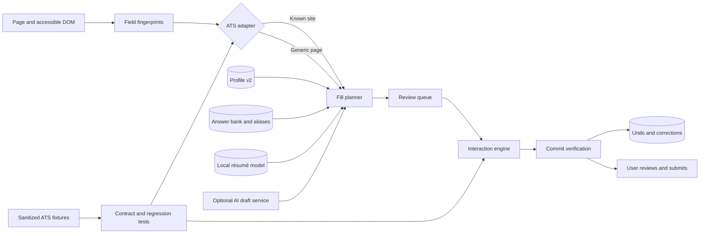

# koalified product and engineering roadmap

This roadmap turns koalified into a dependable, local-first application assistant. It is intentionally larger than a feature list: it defines the safety boundaries, architecture, delivery order, compatibility targets, and acceptance criteria that should guide individual GitHub issues and pull requests.

## North star

Open an application, press **Review this page**, and receive a complete, explainable draft of every safe field koalified can answer. Nothing is committed without approval, uncertain answers remain visible, and koalified never creates an account, advances the application, or submits it.

Success means:

- Common contact fields are filled correctly on the first attempt at least 99% of the time in the fixture suite.
- Supported ATS adapters commit native and custom controls at least 95% of the time in maintained fixtures.
- Every proposed value shows its source: profile, résumé import, saved answer, correction, or AI draft.
- A failed field says whether it was unrecognized, missing profile data, unsupported, rejected by the page, or intentionally protected.
- Every fill operation can be undone until the page changes or reloads.
- Local profile and résumé parsing work without a server; AI is optional and explicitly invoked.

## Product boundaries

koalified will:

- fill only after a user-triggered scan and review;
- preserve values already typed unless the user explicitly chooses to replace them;
- allow explicit saved answers for legal questions while never inferring them;
- keep the canonical profile, corrections, answer bank, and backups local;
- show character and word limits before an AI draft is accepted;
- treat uploaded résumés as source material that must pass an import review.

koalified will not:

- create accounts, solve CAPTCHAs, click **Next**, click **Apply**, or submit applications;
- infer work authorization, sponsorship, demographic, disability, veteran, criminal-history, salary, or consent answers;
- copy or decompile proprietary extensions, APIs, assets, or source code;
- send profile or résumé content to an AI provider without an explicit user action.

Public extensions may be studied only for publicly documented behavior and interaction patterns. koalified's implementation, fixtures, wording, and assets must remain original.

## Target architecture

The key design decision is to separate five concerns:

1. **Fingerprinting** gathers labels, question text, section headings, ARIA data, autocomplete hints, constraints, and nearby controls without assigning an answer.
2. **Classification** identifies the semantic field and confidence using deterministic rules first, saved aliases second, and optional AI only for unresolved open-ended questions.
3. **Planning** maps profile records to page rows, including repeated education and employment sections, without touching the page.
4. **Interaction** uses a control-specific adapter to type, click, select, upload, or choose a date.
5. **Verification** reads the page state back and reports success only when the application accepted the value.

## Delivery plan

### Phase 0 — Reliability baseline and observability

Goal: make every failure understandable before expanding coverage.

- Replace label-only matching with a structured field fingerprint: explicit label, question text, placeholder, `name`, `id`, `autocomplete`, ARIA relationships, section heading, control type, constraints, and site metadata.
- Fix confidence ranking and require deterministic tie-breaking.
- Record scan outcomes as `ready`, `missing-profile`, `unsupported-control`, `protected`, `already-filled`, or `unrecognized`.
- Add a local diagnostics view that redacts values by default and can copy a sanitized field report for bug reports.
- Detect SPA navigation and rescan without duplicate listeners or panels.
- Traverse same-origin iframes and open shadow roots; explain inaccessible cross-origin frames.
- Never count a field as filled until its displayed and underlying state pass verification.

Exit criteria:

- A user can tell why the `Location (City)` field was skipped.
- Standard HTML `autocomplete` tokens are classified correctly.
- Native inputs, selects, listbox-backed inputs, and editable comboboxes have commit-verification tests.
- No test fixture reports success while leaving the control visually blank.

### Phase 1 — Test lab and adapter contract

Goal: make compatibility work repeatable instead of testing against live applications.

- Define an adapter interface for `detect`, `fingerprint`, `plan`, `interact`, `verify`, and `undo`.
- Add sanitized fixtures for plain HTML, React-controlled inputs, portals, listboxes, typeaheads, repeated sections, date controls, and delayed rendering.
- Create contract tests every adapter must pass.
- Add a manual compatibility checklist for Chrome stable on macOS and Windows.
- Add regression fixtures from reported failures without retaining employer names, job descriptions, or personal data.
- Add CI for syntax checks, unit tests, fixture tests, and manifest validation.

Exit criteria:

- New adapters can reuse the planner and review UI.
- A compatibility regression fails in CI before release.

### Phase 2 — Profile v2 and repeatable records

Goal: represent the résumé faithfully rather than forcing one education and one experience into flat fields.

- Introduce a versioned profile schema and migrations.
- Support ordered arrays for education, employment, projects, certifications, links, skills, and languages.
- Give every record a stable local ID and `primary` marker.
- Add repeatable editors in the popup or a full extension page, with reorder, duplicate, archive, and validation.
- Add date precision (`day`, `month`, `year`, `present`) and normalized locations.
- Maintain display aliases separately from canonical values, such as degree names and employer abbreviations.
- Preserve existing 0.1 profiles through automatic migration and rollback-safe backups.

Exit criteria:

- Multiple education and employment records survive save, reload, export, and migration.
- The planner can map the first N profile records to N existing page rows without duplication.

### Phase 3 — Local résumé PDF import with review

Goal: turn a local PDF into proposed profile changes without silently overwriting the profile.

- Bundle a Manifest V3-compatible PDF text extractor; do not load executable code from a CDN.
- Read the PDF in the extension context and keep the original file local.
- Detect image-only PDFs and explain that OCR is not yet available instead of returning an empty import.
- Parse contact details, education, employment, projects, skills, links, and date ranges into a proposed Profile v2 document.
- Show an import diff with `add`, `replace`, `keep existing`, and `ignore` per field or record.
- Display extraction provenance and confidence for every proposal.
- Add fixtures for one-column, two-column, multi-page, and malformed PDFs.
- Make optional AI cleanup a separate explicit action with a payload preview.

Exit criteria:

- Import never mutates the saved profile before confirmation.
- A user can import a résumé, review changes, and undo the accepted import.
- PDF content is not transmitted during local extraction.

### Phase 4 — Inline AI drafting and answer constraints

Goal: draft open-ended responses where deterministic profile mapping is insufficient.

- Detect textareas and rich-text inputs as questions, even when the surrounding text is not phrased with a question mark.
- Capture the field prompt, section context, job context selected by the user, maximum length, minimum length, and word/character units.
- Add a **Draft** action beside unresolved open-ended fields in the review queue.
- Build prompts from selected résumé facts and saved answers, with an instruction to avoid inventing claims.
- Enforce limits locally after generation and offer `shorten`, `expand`, and `regenerate` actions.
- Show the exact source facts used and require approval before filling.
- Add cancellation, timeouts, provider errors, rate-limit messages, and retry behavior.
- Store accepted drafts only when the user chooses **Save for similar questions**.
- Add provider-specific payload tests with secrets and personal data redacted from logs.

Exit criteria:

- Drafts respect hard character limits after local validation.
- No draft is generated or filled automatically.
- Disconnected or misconfigured AI leaves deterministic autofill fully usable.

### Phase 5 — Greenhouse and Lever adapters

Goal: ship two focused adapters on top of the shared contract.

Greenhouse:

- Detect hosted and embedded application forms.
- Support contact details, links, résumé upload, native/custom selects, repeated education and employment, and required-field status.
- Handle fields rendered by company-specific custom questions without guessing protected answers.

Lever:

- Detect hosted and embedded forms.
- Support contact details, links, résumé upload, location typeaheads, additional information, and custom questions.
- Preserve any content the user already entered.

Shared exit criteria:

- Each adapter has sanitized fixtures and a versioned capability matrix.
- Adapter-specific selectors are contained in adapter modules, not the generic matcher.
- Unsupported controls appear in diagnostics rather than disappearing.

### Phase 6 — Workday interaction engine

Goal: handle Workday as a distinct dynamic application UI rather than a collection of selectors.

- Detect Workday tenant variants and page transitions.
- Support custom selects, listbox portals, search-backed typeaheads, phone country controls, and location suggestions.
- Add date adapters for month/year, full dates, and calendar popovers.
- Add repeatable education, employment, language, skills, and website sections idempotently.
- Wait for mutations with bounded timeouts instead of fixed sleeps where possible.
- Verify underlying state, validation messages, and visible chips after every interaction.
- Persist a page-local plan across user-controlled navigation while never clicking navigation controls.

Exit criteria:

- Rerunning koalified does not add duplicate repeated rows.
- A field is marked filled only after Workday's state and validation accept it.
- Location, country, and phone controls work in maintained tenant fixtures.

### Phase 7 — Saved corrections, aliases, and answer bank

Goal: let koalified improve from explicit user corrections without opaque learning.

- Create stable question fingerprints from normalized prompt, answer type, choices, site family, and optional employer scope.
- Let the user save a correction as global, ATS-specific, domain-specific, or one-time.
- Store answer aliases separately from profile facts.
- Support one-click choices for previously answered custom questions.
- Detect choice-set changes and require review instead of reusing a stale option.
- Provide a searchable manager to edit, scope, disable, or delete saved answers and aliases.
- Never save protected answers implicitly.

Exit criteria:

- Every reused correction shows when and why it matched.
- Deleting an alias immediately removes it from future plans.

### Phase 8 — Undo, backup, and recovery

Goal: make local-only storage safe enough for long-term personal use.

- Capture a page snapshot of touched controls immediately before filling.
- Add **Undo last fill** and show fields that cannot be restored safely.
- Keep a bounded local history with no API keys in snapshots.
- Export a versioned JSON backup with schema and checksum.
- Import through validation, migration, and a review diff.
- Support separate exports for profile, answer bank, and settings.
- Offer optional passphrase encryption as a later enhancement; clearly label plain JSON exports.
- Add corruption recovery and a **Reset local data** confirmation flow.

Exit criteria:

- Fill, undo, export, clear, import, and compare restore the same non-secret data.
- Malformed or newer-schema backups fail safely without modifying storage.

### Phase 9 — Coverage expansion and release quality

Goal: broaden support without weakening the core reliability bar.

- Prioritize Ashby, SmartRecruiters, Workable, iCIMS, Jobvite, Taleo, BambooHR, Rippling, Recruitee, Pinpoint, and SuccessFactors using issue evidence.
- Add résumé upload and tailored-document selection while keeping file choice user-approved.
- Add accessibility checks for keyboard navigation, focus order, announcements, contrast, and reduced motion.
- Add performance budgets for scan time, mutation observers, and extension bundle size.
- Document permissions, provider data flow, threat model, local-data deletion, and Chrome Web Store privacy disclosures.
- Establish semantic versions, changelogs, signed release archives, and rollback notes.

Exit criteria:

- Every claimed ATS has fixtures, a capability matrix, and a named maintainer status.
- Releases are reproducible and their permissions match the documentation.

## Proposed GitHub issue map

The roadmap should be tracked by one issue per independently reviewable outcome, with smaller implementation issues linked beneath each epic when work begins.

| Priority | Issue | Phase | Depends on |
| --- | --- | --- | --- |
| P0 | Structured field fingerprints, ranking, and scan diagnostics | 0 | — |
| P0 | Interaction verification for native inputs and suggestion controls | 0 | — |
| P0 | Sanitized fixture lab and adapter contract | 1 | field fingerprints |
| P1 | Profile v2 schema, migration, and repeatable editor | 2 | fixture lab |
| P1 | Repeated-section planning and idempotent row mapping | 2 | Profile v2, adapter contract |
| P1 | Local PDF extraction and image-only detection | 3 | Profile v2 |
| P1 | Résumé import diff, provenance, and undo | 3 | PDF extraction, undo foundation |
| P1 | Inline AI drafting with limits and source grounding | 4 | field fingerprints, Profile v2 |
| P1 | Greenhouse adapter and fixtures | 5 | adapter contract, Profile v2 |
| P1 | Lever adapter and fixtures | 5 | adapter contract, Profile v2 |
| P1 | Workday selects, listboxes, and typeaheads | 6 | adapter contract, verification |
| P1 | Workday calendars and repeated sections | 6 | Workday controls, repeated planner |
| P2 | Saved corrections and scoped answer aliases | 7 | question fingerprints |
| P2 | Answer-bank manager and protected-answer policy | 7 | corrections storage |
| P2 | Undo last fill and bounded local history | 8 | interaction verification |
| P2 | Versioned import/export backup and recovery | 8 | Profile v2, answer bank |
| P2 | SPA, iframe, and shadow-root coverage | 0/9 | diagnostics |
| P2 | ATS compatibility matrix and next-adapter program | 9 | first three adapters |
| P2 | Accessibility, performance, permissions, and release pipeline | 9 | fixture lab |

## Pull request policy

- Keep pull requests scoped to one issue or one vertical slice.
- Include tests or a fixture for every compatibility fix.
- State privacy and permission impact in the PR description.
- Add sparse comments only where browser behavior, safety policy, or a non-obvious tradeoff would otherwise be lost.
- Do not merge an adapter based only on a live-site manual test; add a sanitized regression fixture.
- Prefer feature flags for incomplete schema migrations and adapter rewrites.
- Use squash merges for small fixes and normal merge commits for multi-commit feature branches whose history explains migrations or adapters.

## Compatibility report template

Every ATS issue should record:

- ATS and page URL pattern, with employer and job identifiers removed when possible;
- Chrome version and operating system;
- koalified version or commit;
- field label, control type, and expected profile key;
- outcome: not detected, missing profile, wrong match, interaction failed, verification failed, or protected;
- sanitized DOM/ARIA details and screenshot;
- whether the field was already filled;
- whether rerunning koalified caused duplicates;
- a minimal sanitized fixture added by the fix.

## Release sequence

- **0.2 — Explainable autofill:** diagnostics, ranking fixes, verified typeaheads, fixture baseline.
- **0.3 — Real profile:** Profile v2, repeated records, backup preview.
- **0.4 — Résumé import:** local PDF extraction and reviewed import.
- **0.5 — Drafting:** inline AI answers with limits and grounding.
- **0.6 — ATS foundations:** Greenhouse and Lever adapters.
- **0.7 — Workday:** custom controls, calendars, and repeated sections.
- **0.8 — Personal memory:** corrections, aliases, answer bank, and undo.
- **0.9 — Hardening:** expanded ATS coverage, accessibility, performance, and privacy review.
- **1.0 — Stable local-first release:** documented compatibility guarantees, migrations, recovery, and reproducible packaging.

The sequence may change when sanitized failure evidence shows a higher-impact dependency, but the safety boundaries and verification requirements do not.
